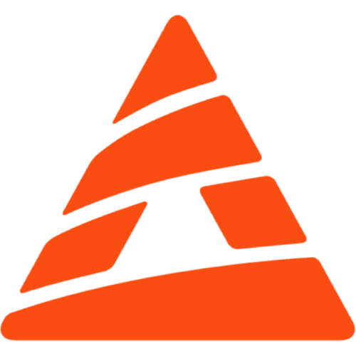

# Olá, eu sou o Lucas! 👋

💻 Estudante de Engenharia de Software e Técnico em Informática, apaixonado por tecnologia, desenvolvimento de sistemas e infraestrutura.

# 💻 Perfil

    import Desenvolvedor from 'Lucas Mir';
    class SobreMim extends Desenvolvedor {
      nome     = 'Lucas Mir Martins';
      area     = 'Desenvolvimento de Software';
      formacao = 'Engenharia de Software';
      local    = 'Uberaba, MG';
    }

- 💻 Técnico em Informática.
- 👨‍🎓 Graduando em Engenharia de Software.
- ☕ Estudando desenvolvimento de software, especialmente Java.
- 🐧 Explorando Linux, servidores, Docker e infraestrutura.
- 🚀 Desenvolvendo projetos próprios para aprimorar minhas habilidades.
- 🤝 Disponível para colaborar em projetos e compartilhar conhecimentos.
- ❤️ Apaixonado por tecnologia, programação, aprendizado contínuo e inovação.
- 🤔 Pergunte-me sobre: Java, Linux, Git e informática.

# ⌨️ Linguagens

  

# 📚 Bibliotecas & Framework

  

# 🛠️ Ferramentas & Plataformas

  

# 🔝 Linguagens mais usadas

  

# 💼 Experiência profissional

  
  <strong>Auxiliar de Técnico de Informática</strong> 
  Uranet / MedNet 
  2025 – 2026

 

  
  <strong>Repositor</strong> 
  Adição Distribuição Express (ABC) 
  2023 – 2024

 

  
  <strong>Auxiliar de Suporte Técnico em Informática</strong> 
  GESET 
  2023

 

# 🎓 Formação acadêmica

  
  <strong>Engenharia de Software</strong> 
  Ampli — Graduação em andamento

 

  
  <strong>Técnico em Informática</strong> 
  CEFORES / UFTM — Concluído

 

  
  <strong>Ensino Médio</strong> 
  Escola Estadual Bernardo Vasconcelos — Concluído

 

# ✉️ Contatos
Conecte-se comigo em outras redes! Se precisar de ajuda ou tiver dúvidas e sugestões, me mande uma mensagem 😉

  
  

# 📈 Estatísticas do GitHub

  

# ☕ Café & Código

Transformando café em código e ideias em projetos! ☕

Sou apaixonado por tecnologia, desenvolvimento de software e aprendizado contínuo. Gosto de explorar novas tecnologias, construir projetos, aprender com os desafios e compartilhar um pouco da minha jornada por aqui.

Acredito que todo grande projeto começa com uma ideia, muita curiosidade e, claro, uma boa xícara de café. 🚀

# 🐍 Gráfico de contribuições

  

 

  

